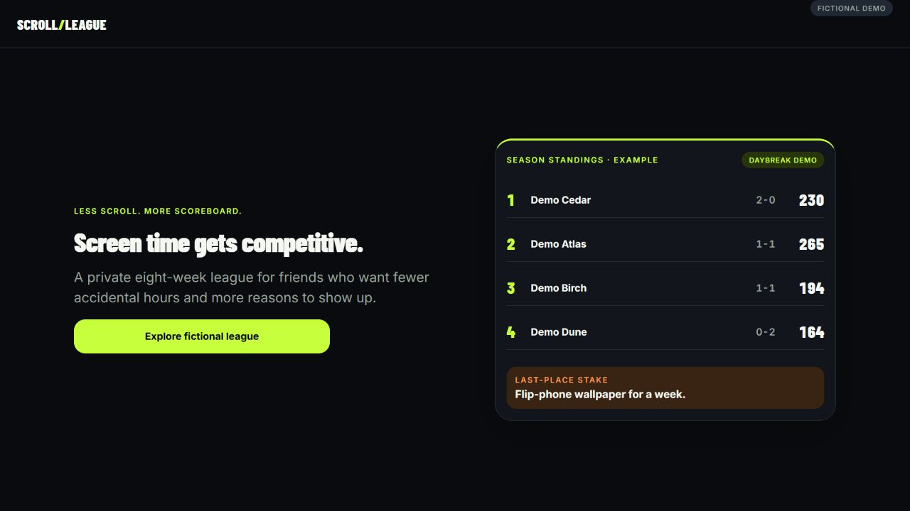

# Scroll League

A browser-first screen-time competition prototype: report recreational phone use, compete against a personal target, and follow weekly matchups, standings, and recaps.

An AI-assisted product project by **Cameron Boyle**. The project demonstrates turning a product brief into a usable interaction flow, making scoring and fairness rules explicit, and carrying those rules through application and database checks. It is a prototype; no adoption or retention outcome is claimed.

## Explore the fictional demo

[Open the live fictional demo](https://cameronjohnboyle2-hub.github.io/scroll-league-showcase/). This repository publishes the reviewed source with fresh history.

The portfolio build uses **Daybreak Demo** with four invented players. It works without an account or backend. Try the entry score preview, the missing-day example in matchups, season standings, and a completed week's recap. Dates stay relative to the league's timezone.



```sh
npm ci --ignore-scripts
npm run export:demo
npm run preview:demo
```

Use Node.js 24. Open **http://127.0.0.1:4179/scroll-league-showcase/demo**. The export is written to `dist-demo/`; serve that directory as a static website. Do not publish the repository root as the website.

The exporter disables dotenv loading, excludes inherited public backend settings, and forces every product route into demo mode. Signup and join routes redirect to the demo. The demo has no backend client, account session, analytics calls, or external avatar previews. A browser content policy blocks network connections. Interactive previews do not save entries or settings.

The default static path is `/scroll-league-showcase`; `PORTFOLIO_BASE_PATH` can set a different single repository path before exporting. The manual Pages workflow uses this repository's name and publishes only the generated artifact. [Public CI](https://github.com/cameronjohnboyle2-hub/scroll-league-showcase/actions/runs/38023608565) and [demo deployment](https://github.com/cameronjohnboyle2-hub/scroll-league-showcase/actions/runs/38023651922) passed; the hosted core flows were browser-checked on 2026-10-09.

## Product and engineering decisions

- **Fair comparison:** daily scores compare usage with each member's target and clamp at 0–150; weekly target snapshots preserve historical outcomes.
- **Honest missing data:** an entered zero is a reported day; an absent entry scores zero and stays visibly unreported. Future days do not dilute provisional pace.
- **Predictable competition:** round-robin opponents, rotating byes, explicit tie handling, and standings calculated from finalized results.
- **Stable recaps:** deterministic templates summarize saved outcomes. There is no AI-generated coaching or recap service.
- **A future pilot path:** Supabase migrations define membership access, constrained actions, and transactional, idempotent week finalization. The portfolio demo is separate from that authenticated pilot configuration.

The interface uses Expo Router, React Native Web, TypeScript, Inter, and Barlow Condensed. A `UsageDataProvider` boundary keeps manual entry separate from future native ingestion; automatic device screen-time collection is not implemented.

## Verification

```sh
npm run check
npm run export:demo
```

Tests cover scoring anchors, explicit zero versus missing reports, provisional pace, raw-score tie breaks, round-robin pairing, byes, standings, consistent fictional results, calendar validation, demo client isolation, export environment isolation, and the patched route decoder. CI also resets a local Supabase instance and runs database acceptance tests.

See [current verification and limits](docs/STATUS.md), [product requirements](docs/PRD.md), [architecture](docs/ARCHITECTURE.md), and [dependency review](docs/DEPENDENCY_REVIEW.md). A passing local test or simulated phone viewport does not establish a live multi-account pilot or native-device behavior.

## Run the authenticated prototype locally

Use the [Supabase CLI](https://supabase.com/docs/guides/local-development/cli/getting-started) and Docker, then run `supabase start` and `supabase db reset`. Copy `.env.example` to `.env` and supply only the local API URL and local publishable key. Start the app with `npm run web`. The portfolio flag must be unset for this separate development configuration.

The seed is disposable local test data: `demo-atlas@example.test`, `demo-birch@example.test`, `demo-cedar@example.test`, `demo-dune@example.test`, and `demo-elm@example.test` belong to Daybreak Demo. `demo-flint@example.test` and `demo-grove@example.test` exercise a separate isolation league. The local-only password is `Password123!`; invite codes are `DEMO2026` and `OTHER26`. Never apply this seed to a hosted production database.

Hosted authentication, SMTP delivery, database policies, scheduling, and EAS deployment require separate configuration and live acceptance testing. Follow [the deployment runbook](docs/DEPLOYMENT.md) for the authenticated prototype; `export:web` is a pilot export, while `export:demo` is the disconnected portfolio export.

## Source map and rights

`app/` contains fixed routes; `src/domain/` contains pure rules; `src/features/` contains screens; `src/data/` contains backend access; `src/demo/` contains fictional fixtures. `supabase/` contains migrations, local seed, and acceptance tests. `docs/` records decisions and verification evidence.

No general reuse license has been selected for the original project source. See [third-party notices](THIRD_PARTY_NOTICES.md) for fonts, dependencies, and the attributed URL-decoder compatibility patch.
