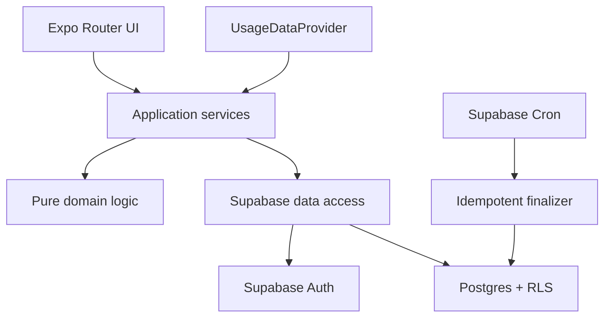

# Target architecture

This document translates the PRD into implementation boundaries. It is subordinate to `docs/PRD.md`.

## System shape



## Fixed route map

| Route | Purpose | Notes |
|---|---|---|
| `/` | Session-aware entry | Redirect to onboarding, home, or demo CTA |
| `/onboarding` | Account and display profile | Email/password, name, optional avatar |
| `/join?code=...` | League join | Show rules before confirmation |
| `/home` | Daily hub | Entry, target, matchup, rank, activity |
| `/league` | Roster and standings | Current season context |
| `/matchup?week=...` | Matchup detail | Daily raw time, scores, trend, result |
| `/entry?date=...` | Fast manual entry | Default to current league-local date |
| `/consequences` | Suggestions, pool, stake, done state | Commissioner controls constrained actions |
| `/recap?week=...` | Stable weekly recap | Render saved recap payload |
| `/profile` | Display profile, target, settings | Target change applies next week |
| `/demo` | Read-only fictional league | Relative-date local fixtures only |

Do not introduce dynamic path segments for the MVP.

## Portfolio export boundary

`npm run export:demo` exports static files with `EXPO_PUBLIC_PORTFOLIO_DEMO=1`, dotenv loading disabled, and inherited public settings excluded. `src/config/runtime.ts` controls both routes and backend creation: the portfolio build constructs no Supabase client. All product routes use fictional snapshots; account/join routes redirect to `/demo`. The generated HTML embeds a connection-denying content policy; the preview server also sends it as a header. Only `dist-demo` is the hosted artifact. Demo avatars never fetch external images.

Sample finalized results, standings, and recap payloads are generated from the same invented entries and weekly target snapshots. The authenticated pilot's persistence boundary and fixed route scheme remain as above. See D-012 and D-013 for the portfolio/dependency decisions.

The portfolio export renders a stable loading shell before client mount. Relative-date fixtures, visitor-local timestamp formatting, font readiness, and responsive viewport branches then render in the browser. This avoids hydrating build-time HTML against a different day, locale, or screen width. The demo requires JavaScript.

## Suggested source boundaries

```text
app/                    Expo Router pages only
src/components/         Reusable presentational UI
src/features/           Feature orchestration and view models
src/domain/             Pure scoring, pairing, standings, dates, recap logic
src/data/               Supabase client, queries, commands, mappers
src/providers/          UsageDataProvider and manual implementation
src/demo/               Read-only fixtures and demo adapter
src/theme/              Tokens and responsive primitives
supabase/migrations/    Versioned schema, grants, RLS, functions, cron
supabase/seed.sql       Reproducible development data
tests/                  Cross-cutting and integration tests
docs/                   Product, architecture, decisions, and runbooks
```

## Domain rules

### Daily scoring

Keep two values in domain calculations:

- `unroundedScore = clamp(0, 150, 100 + 100 * (target - minutes) / target)`
- `displayScore = round(unroundedScore)`

The reported-day contract requires `target > 0` and integer `minutes` from 0 through 1,440. Missing entries are represented as missing, not as zero-minute records. Their score contribution is zero and their status is `unreported`.

### Weekly scoring

- Final score: sum all seven daily score contributions and divide by seven.
- Provisional pace: sum contributions for elapsed local days and divide by elapsed local-day count.
- Future days are omitted from the provisional denominator.
- Save target snapshots in `week_participants`; historical calculations never read the mutable current target.

### Pairing

Generate pairings from eligible `week_participants`. Optimize, in order:

1. Avoid repeat opponents where possible.
2. Balance total byes over the season.
3. Avoid consecutive byes where possible.
4. Resolve equally valid schedules deterministically.

Persist the chosen pairings. Never regenerate an already-created week's bracket from current membership.

### Standings

Derive standings only from finalized `weekly_results`:

1. Win percentage, descending. The working assumption is that ties count as half a win for the percentage numerator.
2. Total season score, descending.
3. Unreported days, ascending.
4. Stable display-name/user-id ordering only for deterministic presentation, not as a competitive tiebreak.

### Recaps

Generate a versioned JSON payload during finalization from saved inputs and deterministic templates. The route renders that saved payload; it does not regenerate copy on every view.

## Database responsibilities

- SQL owns league-local week boundaries, eligibility snapshots, finalization, immutable results, and constrained commissioner mutations.
- The client owns input UX, optimistic display where safe, responsive presentation, and calling allowed queries/functions.
- RLS is the security boundary. Hiding UI controls is not authorization.
- Use database uniqueness constraints as part of idempotency, including one entry per member/local date, one matchup participation per week, and one weekly result per participant/week.

## Usage provider contract

The exact TypeScript shape may evolve, but preserve this semantic boundary:

```ts
export type DailyUsage = {
  localDate: string;
  minutes: number;
  source: 'manual' | 'ios_screen_time' | 'android_usage_stats';
  evidenceRef: string | null;
};

export interface UsageDataProvider {
  read(localDate: string): Promise<DailyUsage | null>;
  submit(input: DailyUsage): Promise<DailyUsage>;
}
```

The manual implementation writes through the same application command future native providers will use.

The implementation lives in `src/providers/usage.ts`. Detailed native handoff notes are in `docs/NATIVE_INGESTION.md`.

## Native ingestion follow-ups

### iOS Screen Time

A future native provider would request Apple Family Controls authorization in an iOS build, select the applicable activity categories/tokens, read aggregated usage through the Screen Time frameworks, normalize it to integer minutes for the league-local date, and submit through `UsageDataProvider`. Entitlements, App Review constraints, shared-device semantics, and whether Apple permits the intended self-tracking flow must be validated before committing to implementation.

### Android UsageStats

A future native provider would send the user to grant Usage Access, query `UsageStatsManager` for the league-local day boundary, map foreground usage into the agreed recreational category policy, normalize it to integer minutes, and submit through `UsageDataProvider`. OEM behavior, time-zone changes, duplicated events, and background/foreground interpretation require device testing.

## Operational dependencies

- Supabase project and project URL/anonymous key
- Custom SMTP configured for live confirmation email
- Expo account and EAS project for hosted web deployment
- Cron enabled for the finalization function
- No service-role credentials in Expo public environment variables
